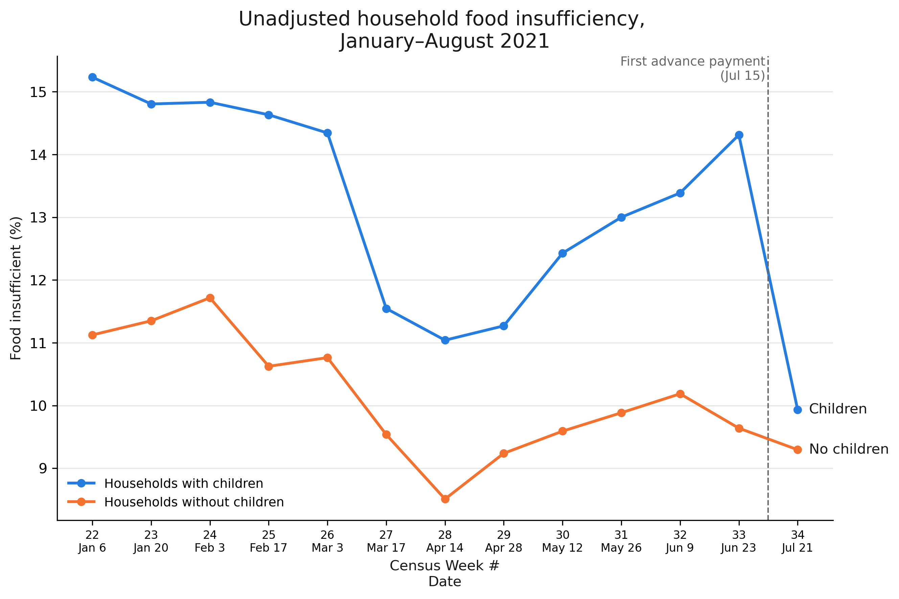
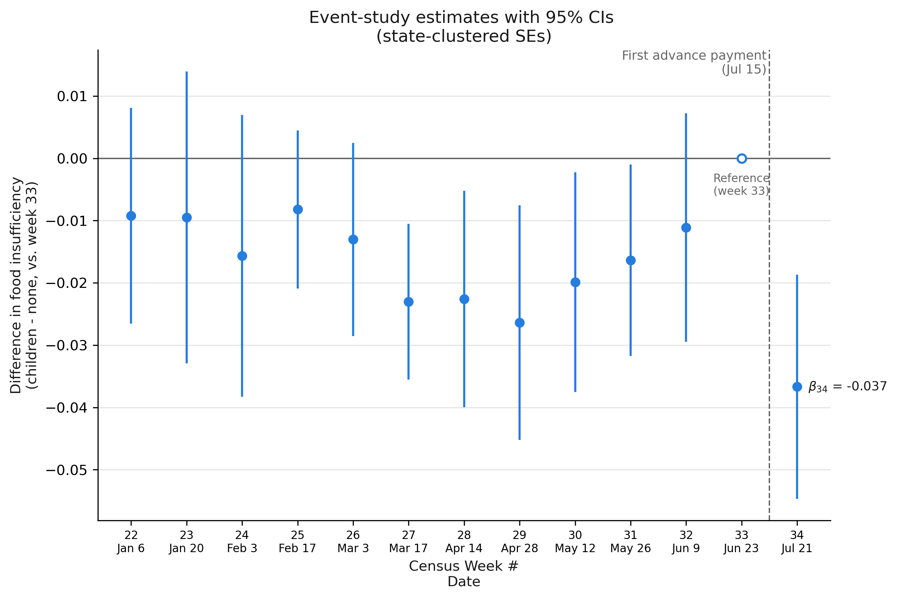
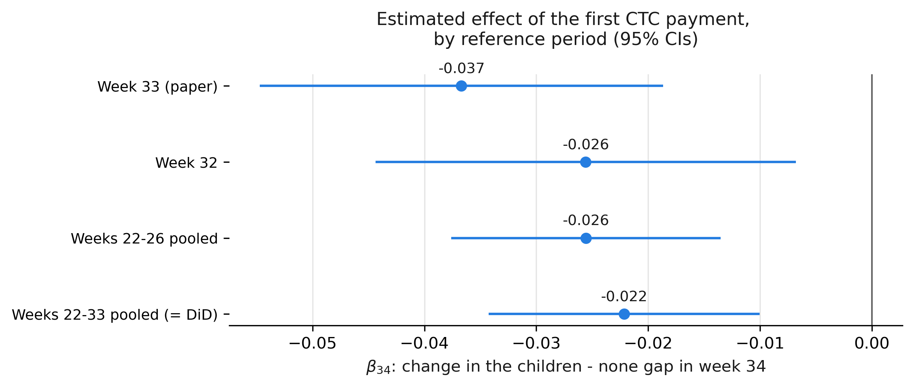
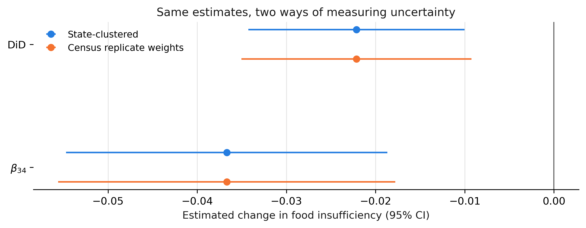
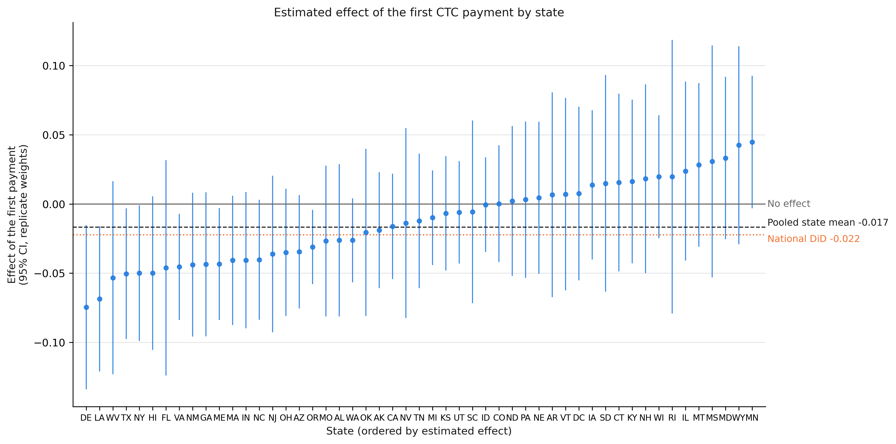

# CTC-Food-Insufficiency
A replication and extension of Shafer et al. (2022), *Association of the Implementation of Child Tax Credit Advance Payments With Food Insufficiency in US Households* (JAMA Network Open 5(1): e2143296), using public Census Household Pulse Survey microdata.

---
*Final project for CSS 211 (Statistical Methods), M.S. in Computational Social Science course at UC San Diego*

## Summary

The expanded Child Tax Credit (CTC) began paying families monthly in July 2021. Shafer et al. compared food insufficiency (not having enough to eat in the last 7 days) among U.S. households with and without children, before and after the first advance payment on July 15, 2021, and reported a 3.7-percentage-point (about 26%) reduction for households with children.

This repository reproduces their analytic sample and main estimates exactly at the paper's reported precision, then tests how robust those estimates are.

| Quantity | Paper | This replication |
|---|---|---|
| Analytic sample (n) | 585,170 | 585,170 |
| Food insufficiency, households with children, week 33 / 34 | 14.3% / 9.9% | 14.3% / 9.9% |
| Event-study estimate, week 34 (95% CI) | -0.037 (-0.055 to -0.019) | -0.037 (-0.055 to -0.019) |
| Pooled difference-in-differences | -0.022 (P = .001) | -0.022 (p = .0006) |

**Beyond the original paper:**

- **The size of the effect depends on the comparison period.** Pre-payment event-study coefficients reject parallel trends under state-clustered standard errors (p = .001). Re-estimating against different reference periods gives effects of 2.2 to 3.7 percentage points; all are negative and statistically significant.
- **Census replicate-weight standard errors (Extension b)** are 6-7% larger than state-clustered ones; the week-34 effect remains significant (p < .001). The parallel-trends test is no longer rejected at the 0.05 level (p = .097).
- **State heterogeneity (Extension a):** there is no detectable variation in the effect across states (Cochran's Q = 58.4 on 50 df, p = .19), though the test has limited power.
- **Survey weights matter:** the unweighted estimate is about a third of the weighted one.
- **Undocumented choices surfaced by the replication:** the paper's missing-data handling and inference method are not stated in its Methods but are needed to reproduce its numbers.

The full write-up follows: [Research questions](#1-research-questions-and-hypotheses) · [Data](#2-data-and-sample) · [Methods](#3-methods) · [Results](#4-results) · [Discussion](#5-discussion) · [Reproducing the analysis](#reproducing-the-analysis)

---

## 1. Research questions and hypotheses

**Primary (replication).** Was the first advance CTC payment on July 15, 2021 associated with a reduction in household food insufficiency among U.S. households with children, relative to households without children, among respondents under 65?

- $H_1$: the event-study coefficient for the first post-payment wave is negative ($\beta_{34} < 0$), near the paper's -0.037.
- $H_0$: $\beta_{34} = 0$.

**Extension (b): inference.** Does the conclusion hold when standard errors are computed with the Census Bureau's 80 replicate weights instead of the state-clustered standard errors used in the paper?

- $H_1$: $\beta_{34}$ remains statistically significant ($H_0: \beta_{34} = 0$, two-sided t-test, $\alpha = 0.05$).

**Extension (a): state heterogeneity.** Does the association differ across states?

- $H_1$: the between-state variance of the effect is greater than zero ($H_0: \tau^2 = 0$).

## 2. Data and sample

**Source.** U.S. Census Bureau Household Pulse Survey (HPS) public use files, weeks 22-34: 13 repeated cross-sectional online survey waves from January 6 to August 2, 2021 (no data were collected July 6-20). Week 34 (July 21 - August 2) is the first wave after the July 15 payment; week 33 (June 23 - July 5) is the last wave before it.

**Outcome.** Household food insufficiency: 1 if the respondent reported that the household *sometimes* or *often* did not have enough to eat in the last 7 days (`CURFOODSUF` codes 3-4), 0 otherwise. Food insufficiency is narrower and more severe than the USDA food insecurity measure.

**Treatment group.** Households with any children under 18 (`THHLD_NUMKID > 0`); households without children are the comparison group.

**Covariates** (following the paper): sex, age group, race and ethnicity, education, household income, marital status, number of adults and children, respondent employment, unemployment insurance and Economic Impact Payment receipt (from the spending-source items), SNAP receipt, food aid receipt, health insurance coverage, and state.

**Sample construction.**

| Step | n |
|---|---|
| All respondents, weeks 22-34 | 949,257 |
| Under age 65 | 667,836 (paper: 667,836) |
| Non-missing food sufficiency | 587,966 |
| Non-missing marital status (analytic sample) | **585,170** (paper: 585,170) |

The paper describes "complete-case analysis, except for income." Reproducing its sample required a narrower rule: only rows missing the outcome or marital status are dropped, and the other covariates with gaps (income, health insurance, SNAP, food aid, employment) keep missing values as their own category. Requiring all eight health insurance items to be answered separately, for example, would have removed about 208,000 rows, because many respondents answer only for the coverage they have; health insurance is therefore one covariate (covered by any type vs. none).

**Questionnaire changes at week 34.** Week 34 began a new questionnaire phase (Phase 3.2), and three items changed at exactly the payment week: sex is asked as sex assigned at birth (`EGENID_BIRTH` instead of `EGENDER`), the spending-source items are renamed (`SPNDSRC` to `SPND_SRC`), and the income question asks about 2020 income instead of 2019 income. These are harmonized across weeks, but a control whose meaning shifts in the treatment wave is a potential source of bias.

**Weights.** Household weights are divided by 13 when weeks are pooled, as in the paper and as the Census Bureau recommends for pooled estimates.

## 3. Methods

All replication models are weighted linear probability models (least squares on the 0/1 outcome), with standard errors clustered by state and a t-distribution with 50 degrees of freedom (51 states (DC included) minus 1).

**Pooled difference-in-differences (DiD).** Compares week 34 with the average of all 12 pre-payment waves:

$$Y_{isw} = \alpha + \beta\,(Kids_i \times Post_w) + \delta\,Kids_i + \lambda_w + \mu_s + X_i'\gamma + \varepsilon_{isw}$$

where $i$ is the respondent, $s$ the state, $w$ the wave, $\lambda_w$ wave fixed effects, $\mu_s$ state fixed effects, and $X_i$ the covariates.

**Event study (the paper's primary model).** Interacts the children indicator with every wave, using week 33 as the reference:

$$Y_{isw} = \alpha + \sum_{w \neq 33} \beta_w\,(Kids_i \times W_w) + \delta\,Kids_i + \lambda_w + \mu_s + X_i'\gamma + \varepsilon_{isw}$$

$\beta_{34}$ is the estimate of interest. The pre-payment coefficients ($\beta_{22}$ to $\beta_{32}$) test the parallel-trends assumption: without the payment, food insufficiency would have moved in parallel for the two groups.

**Robustness and sensitivity.** (1) A weighted logistic DiD, converted to probability units (average marginal effect), because linear probability models can predict values outside 0-1. (2) The event study re-estimated against different reference periods: week 32, weeks 22-26 pooled, and all pre-payment weeks pooled (equivalent to the DiD).

**Extension (b).** Each model is re-estimated with each of the 80 Census replicate weights, and the variance is computed by successive difference replication (U.S. Census Bureau, 2021b, pp. 12-13):

$$\text{Var}(\hat\beta) = \frac{4}{80}\sum_{r=1}^{80}\left(\hat\beta_r - \hat\beta\right)^2$$

Tests use a t-distribution with 80 degrees of freedom. The parallel-trends joint test is repeated with the replicate covariance matrix.

**Extension (a).** A separate DiD effect is estimated for each state in one weighted regression (with state-specific baselines and state-specific gaps between households with and without children), with replicate-weight standard errors. Cochran's Q tests whether the 51 state effects vary more than sampling error would produce ($\chi^2$ with 50 df); the DerSimonian-Laird method estimates $\tau$, the standard deviation of true effects across states. The proposal planned a mixed model with a state random slope; it could not be estimated reliably (see Limitations), and this approach tests the same null hypothesis while keeping the survey weights.

## 4. Results

### 4.1 Unadjusted trends



Food insufficiency among households with children fell from 14.3% in week 33 to 9.9% in week 34, while households without children barely changed (9.6% to 9.3%). The gap between the groups shrank from 4.7 to 0.6 percentage points, the smallest of any wave. The gap was not stable before the payment: about 3-4 points in January to early March, 2-2.5 points from mid-March to early May, then a peak of 4.7 in late June.

### 4.2 Replication

| Model | Estimate | 95% CI | p |
|---|---|---|---|
| Pooled DiD | -0.022 | -0.034 to -0.010 | .0006 |
| Event study, $\beta_{34}$ | -0.037 | -0.055 to -0.019 | < .001 |

Relative to the week-33 baseline of 14.3%, the event-study estimate is about a 26% reduction, matching the paper's 25.9%. Both estimates reproduce the paper at its reported precision. The confidence intervals match the paper only when p-values use a t-distribution with 50 degrees of freedom; with statsmodels' default normal distribution, the DiD p-value is .0002 instead of .0006, which suggests the paper used small-sample cluster inference, a choice its Methods do not state.

### 4.3 Parallel trends



The joint test rejects the hypothesis that all pre-payment coefficients are zero (F = 3.46, p = .001). Weeks 27-31 (mid-March to early June) are all negative and individually significant (-0.016 to -0.026): the gap between households with and without children was 2-3 points smaller in spring than in week 33.

### 4.4 Robustness: functional form

27.8% of the linear model's fitted values fall below zero (none above one), a known limitation with a rare outcome. The logistic DiD gives an average marginal effect of -0.021, nearly identical to the linear estimate of -0.022, so the result does not depend on the linear model's out-of-range predictions.

### 4.5 Sensitivity to the reference period



| Reference period | $\beta_{34}$ | 95% CI | p |
|---|---|---|---|
| Week 33 (paper) | -0.037 | -0.055 to -0.019 | < .001 |
| Week 32 | -0.026 | -0.044 to -0.007 | .009 |
| Weeks 22-26 pooled | -0.026 | -0.038 to -0.014 | < .001 |
| Weeks 22-33 pooled (= DiD) | -0.022 | -0.034 to -0.010 | < .001 |

The effect is negative and significant under every reference period, but its size ranges from 2.2 to 3.7 percentage points. The paper's reference week, which has the widest pre-payment gap, gives the largest estimate.

### 4.6 Extension (b): replicate-weight standard errors



| Estimate | SE (clustered) | SE (replicate) | 95% CI (replicate) | p (replicate) |
|---|---|---|---|---|
| Pooled DiD | 0.0060 | 0.0065 | -0.035 to -0.009 | .001 |
| $\beta_{34}$ | 0.0090 | 0.0095 | -0.056 to -0.018 | < .001 |
| Pre-trend joint test | F = 3.46, p = .001 | F = 1.67, p = .097 | | |

**Hypothesis (b) is supported:** $\beta_{34}$ remains significant under replicate-weight standard errors (t = -3.86, p < .001, 80 df). Replicate standard errors are only 6-7% larger than clustered ones. The parallel-trends test, however, is not rejected at the 0.05 level with replicate weights. Because individual standard errors barely differ, the difference comes from how each method estimates correlations among the 11 pre-period coefficients; cluster-robust joint tests can over-reject when many restrictions are tested with relatively few clusters (Cameron & Miller, 2015).

### 4.7 Extension (a): state heterogeneity



**Hypothesis (a) is not supported:** the state effects vary no more than sampling error would produce (Q = 58.4 on 50 df, p = .19; $\tau$ = 0.010; $I^2$ = 14%). Seven states have confidence intervals entirely below zero and none entirely above, consistent with a negative average effect. The pooled state mean (-0.017) is smaller than the national DiD (-0.022) because it weights states by the precision of their estimates rather than by population.

### 4.8 The role of survey weights

The unweighted DiD with state fixed effects is -0.007 (SE 0.003), about a third of the weighted -0.022. Survey weights give more influence to groups that respond to the survey less often, such as lower-income and less-educated households, so the larger weighted estimate suggests the association was concentrated in those groups.

## 5. Discussion

**The paper replicates.** Using only public data and the paper's description, its analytic sample, unadjusted rates, and both main estimates are reproduced at the reported precision. Two choices needed to do so (the missing-data rule and the small-sample inference) are not in the paper's Methods; documenting them is a contribution of this replication.

**The direction of the finding is robust; its size is less certain.** Every specification shows a significant reduction in food insufficiency among households with children after the first payment: 2.2 to 3.7 percentage points depending on the comparison period, robust to functional form, variance method, and (with limited power) consistent across states.

**Why the pre-payment gap moved.** Two explanations are plausible but untested here. The spring narrowing (weeks 27-31) coincides with the third round of Economic Impact Payments under the American Rescue Plan, which began reaching households in mid-March 2021 and included \$1,400 per dependent, so they were larger for households with children; a temporary narrowing then is what the CTC hypothesis itself predicts for a cash payment. The June widening may reflect children losing school meals when the school year ends. If so, that loss continues into week 34 (late July), which makes week 33 the most comparable reference and the paper's 3.7-point estimate more appropriate than the smaller estimates from school-year baselines. These data contain only one summer, so this cannot be tested here.

**Limitations.**

- **Association, not causation.** The design relies on households without children as a counterfactual, and the pre-payment gap was not stable; the parallel-trends evidence depends on the variance method.
- **Concurrent changes in week 34.** The new questionnaire phase changed three items at the payment week, and a two-week gap in data collection separates weeks 33 and 34.
- **Low response rates.** Pulse response rates were in the single digits during this period; weights adjust for nonresponse but cannot remove all bias.
- **One post-payment wave.** The analysis covers only the first payment.
- **Measurement.** Food insufficiency captures only the most severe hardship, and age is approximated from birth year.
- **The planned mixed model could not be estimated.** statsmodels' `MixedLM` produced singular covariance matrices and invalid log-likelihoods at this sample size and cannot use survey weights; the two-stage approach replaced it (details in the appendix of `extensions.ipynb`).
- **Limited power for state differences.** State-level standard errors (0.013 to 0.050) are larger than the estimated spread across states, so moderate differences cannot be ruled out.

**Future work.** Data from summer 2022, after the payments expired, would allow a direct test of the seasonal explanation; a follow-up study found that food insufficiency among households with children rose after the payments ended (Bovell-Ammon et al., 2022). The weighting result also suggests estimating effects separately by income group.

## 6. Conclusion

The first advance Child Tax Credit payment was associated with a 2.2 to 3.7 percentage-point reduction in food insufficiency among U.S. households with children, roughly a quarter of the pre-payment rate. The paper's estimate reproduces exactly; its magnitude depends on the comparison period, and its statistical significance holds under the Census Bureau's recommended variance method.

---

## Repository structure

```
CTC-Food-Insufficiency/
├── data/                   # not tracked by git (see Data below)
│   ├── raw/                # Census zip files and their extracted CSVs
│   └── processed/          # analysis files and cached replicate-weight results
├── figures/                # figures saved by the notebooks
├── modules/
│   ├── get_data.py         # download and unzip the Census files
│   ├── prepare_pulse.py    # stack weeks, harmonize variables, build the analytic sample
│   ├── analysis.py         # replication models (DiD, event study, sensitivity checks)
│   └── extensions.py       # replicate-weight inference and state heterogeneity
├── notebooks/
│   ├── data_prep.ipynb     # 1. build the analysis files
│   ├── replication.ipynb   # 2. reproduce the paper's estimates
│   └── extensions.ipynb    # 3. Extensions (a) and (b)
├── requirements.txt
└── README.md
```

## Getting the data

The data are public and de-identified but not included in this repository because of their size (about 1 GB). Each week's zip contains the main data file, a replicate-weight file, and a data dictionary. There are two ways to get them:

1. **Automatic:** set `DOWNLOAD = True` in the first step of `notebooks/data_prep.ipynb` to download all 13 zips from Census into `data/raw/`.
2. **Manual:** download the weeks 22-34 CSV zips from the [Census 2021 Household Pulse Survey data page](https://www.census.gov/programs-surveys/household-pulse-survey/data/datasets.2021.html) and place them, still zipped and with their original names (e.g. `HPS_Week22_PUF_CSV.zip`), in `data/raw/`.

The notebook unzips the files and builds everything else.

## Setup

Requires Python 3 with the packages in `requirements.txt`:

```bash
git clone git@github.com:Roseyroseo/CTC-Food-Insufficiency.git
cd CTC-Food-Insufficiency
pip install -r requirements.txt
```

The models fit on about 585,000 rows; 8 GB of RAM or more is recommended. The state-level model in `extensions.ipynb` needs roughly 2-3 GB on its own.

## Reproducing the analysis

Run the notebooks in order:

1. **`data_prep.ipynb`:** downloads (optionally) and unzips the raw files, checks variable names across weeks, stacks the 13 weeks, builds derived variables, and saves the analytic sample. It stops with an error if the sample does not reproduce the paper's n = 585,170.
2. **`replication.ipynb`:** unadjusted rates, the pooled difference-in-differences, the event study and its parallel-trends test, a logistic robustness check, and the sensitivity of the week-34 estimate to the reference period.
3. **`extensions.ipynb`:** Extension (b), Census replicate-weight standard errors, and Extension (a), state heterogeneity. Replicate-weight results are cached in `data/processed/replicate_cache/`, so only the first run is slow.

## References

- Bovell-Ammon, A., McCann, N. C., Mulugeta, M., Ettinger de Cuba, S., Raifman, J., & Shafer, P. (2022). Association of the expiration of Child Tax Credit advance payments with food insufficiency in US households. *JAMA Network Open, 5*(10), e2234438. https://doi.org/10.1001/jamanetworkopen.2022.34438
- Cameron, A. C., & Miller, D. L. (2015). A practitioner's guide to cluster-robust inference. *Journal of Human Resources, 50*(2), 317-372.
- Seabold, S., & Perktold, J. (2010). statsmodels: Econometric and statistical modeling with Python. *Proceedings of the 9th Python in Science Conference* (pp. 92-96). https://doi.org/10.25080/Majora-92bf1922-011
- Shafer, P. R., Gutiérrez, K. M., Ettinger de Cuba, S., Bovell-Ammon, A., & Raifman, J. (2022). Association of the implementation of Child Tax Credit advance payments with food insufficiency in US households. *JAMA Network Open, 5*(1), e2143296. https://doi.org/10.1001/jamanetworkopen.2021.43296
- U.S. Census Bureau. (2021a). *Household Pulse Survey public use files, weeks 22-34* [Data set]. https://www.census.gov/programs-surveys/household-pulse-survey/data/datasets.2021.html
- U.S. Census Bureau. (2021b). *Source of the data and accuracy of the estimates for the Household Pulse Survey - Phase 3.1* [Week 33]. https://www2.census.gov/programs-surveys/demo/technical-documentation/hhp/Phase3-1_Source_and_Accuracy_Week_33.pdf

## Author

Rosey A. Gutiérrez
